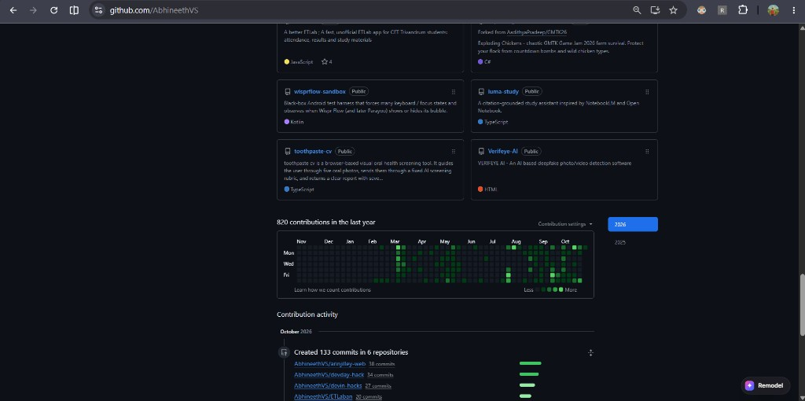
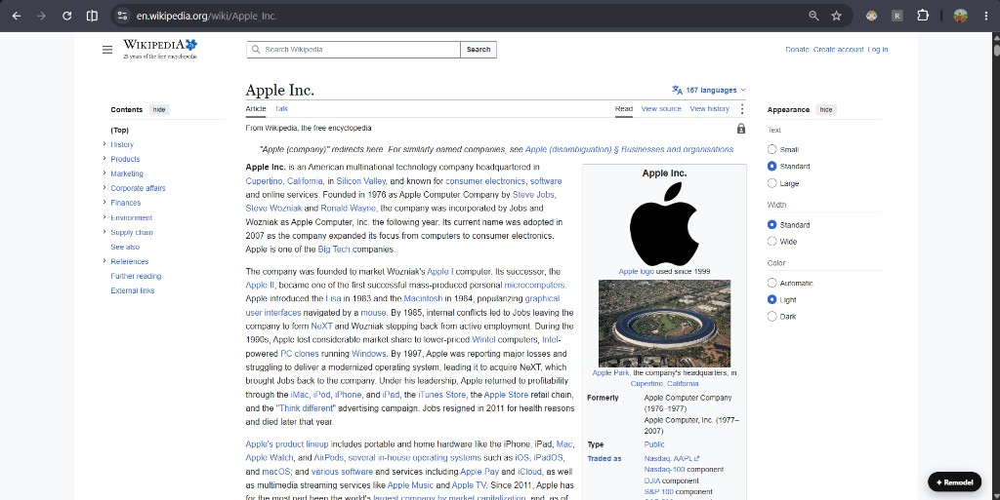
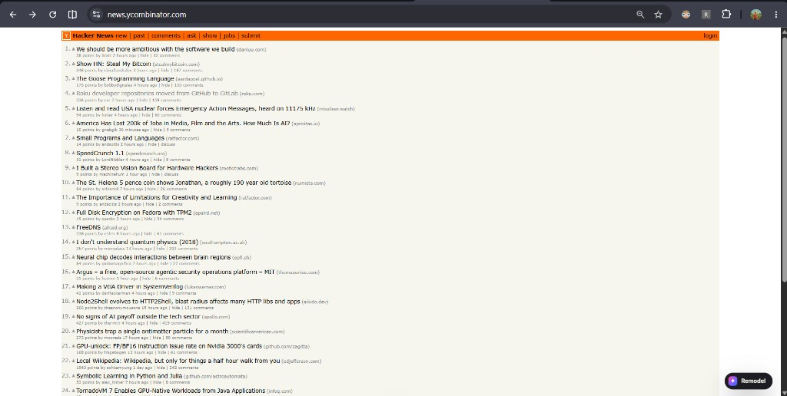
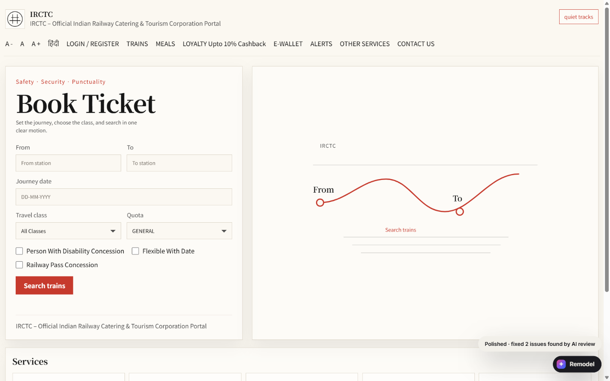

# Remodel

**Give any website a new look with one sentence.**

Remodel is a Chrome extension. Open a website, type the style you want (for example "cyberpunk" or "neo-brutalist magazine"), and Remodel redesigns the page for you. The site keeps working: links, search, logins and forms still do what they did before.

## Demo videos

- [python.org, pink neo-brutalist reskin](https://youtu.be/dNEG0L8O_Oc). Same page, repainted in loud pink with thick borders and heavy type.
- [GitHub, neon reskin](https://youtu.be/Xa5lt1BeMjs). GitHub stays put. The colours and type turn neon.
- [Wikipedia's Apple article, rebuilt](https://youtu.be/PlnK9Iw7WgI). The article gets a new layout, in a clean Apple-keynote style.
- [Cyberpunk redesign](https://youtu.be/-1QaEpzxPYg). A page redesigned in a dark, neon Cyberpunk 2077 look.

## Before and after

**GitHub, "cyberpunk / futuristic"**: the layout stays the same, and the colours, fonts and shapes change.

Before

After

**Wikipedia's Apple Inc. article, rebuilt**: the whole page gets a new layout, in a clean Apple-keynote style.

Before

After

**Hacker News, as a retro desktop**: the same live stories, inside a 90s-style computer window.

Before

After

**IRCTC train search, as a calm Japanese rail planner**: the same booking form in a quiet layout. It still fills in IRCTC's real form, so searching shows real trains. The AI checked its own screenshot and fixed two mistakes before this shot.

Before

After

## Two ways to remodel

- **Reskin** (most websites): keeps the page exactly where it is and repaints it with new colours, fonts, rounded or sharp corners, and shadows. It takes about 10 seconds, and nothing on the page moves or breaks.
- **Rebuild** (Wikipedia, Hacker News, IRCTC train search): designs a brand-new page from the content, with its own layout and scroll animations. On IRCTC, the new booking form still searches real trains.

## Other things it does

- **Suggest prompts:** not sure what to type? Remodel looks at the page and suggests three styles.
- **Reuse a style:** a style you made on one site applies instantly on another.
- **Before / after switch:** press `Alt+R` to flip between the original and the new design.
- **Remix a section:** on Wikipedia, hover over any section and restyle just that part.
- **Watch it work:** while it designs, five little cursors visibly edit the page, retyping headings, moving blocks and picking colours.
- **Self-check:** after a rebuild, the AI looks at a screenshot of its own result and fixes obvious mistakes.

## Try it

1. Open `chrome://extensions` and turn on **Developer mode**.
2. Click **Load unpacked** and choose the `extension` folder.
3. Open any website and click the **✦ Remodel** button in the bottom-right corner (or press `Alt+Shift+M`).
4. Paste your OpenAI API key. It stays in your browser.
5. Type a style and press **Reskin this page** (or **Remodel this page** on Wikipedia, Hacker News and IRCTC).

## Good to know

- Pictures and logos keep their original colours.
- On IRCTC, Remodel stops at train search. Login, booking and payment happen on the real IRCTC site.

## More docs

- [How AI was used to build this](AI_USAGE.md)
- [What it does and its limits](docs/PRODUCT.md)
- [Demo script](docs/DEMO_SCRIPT.md)
- [Change log](CHANGELOG.md): everything that was built, in order
- [Technical contracts](CONTRACTS.md): data shapes and messages, for developers
- [Credits for design data and fonts](third_party/NOTICES.md)
